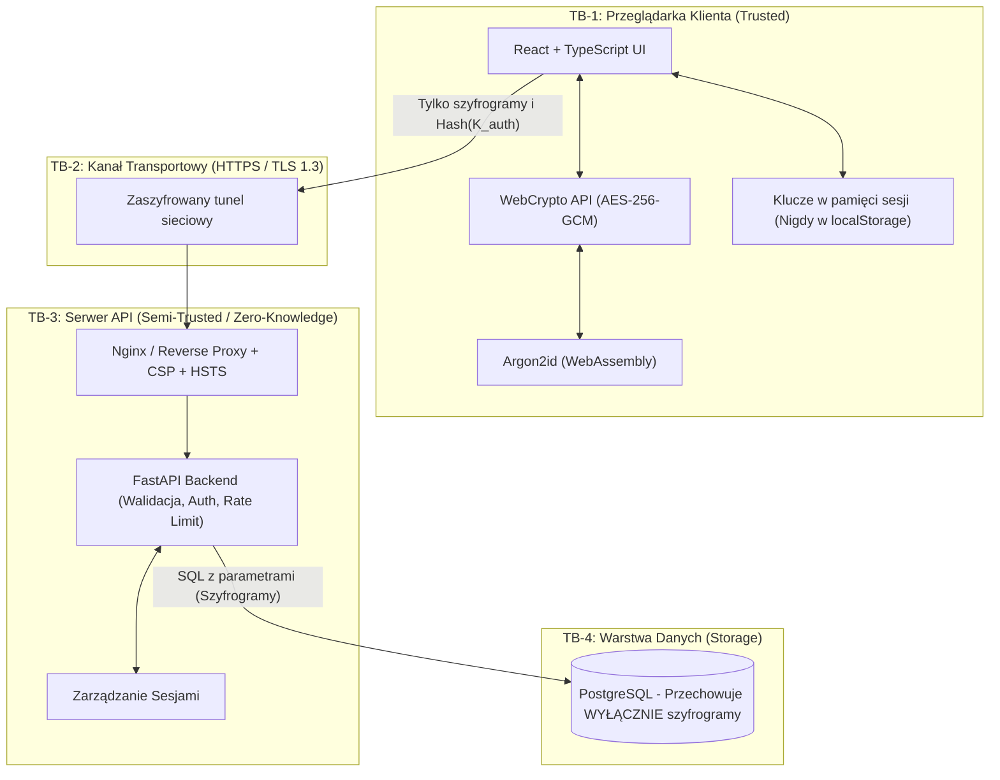
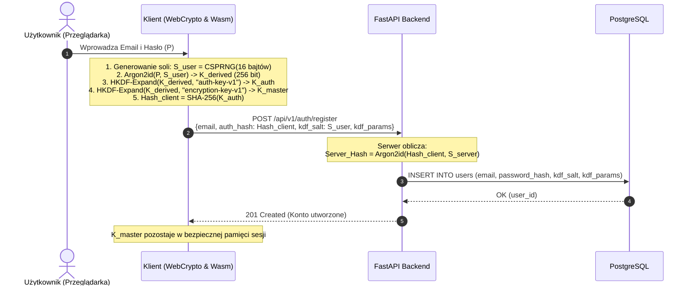
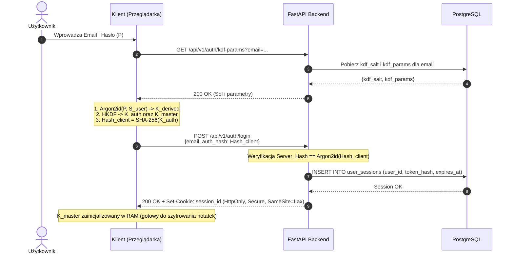
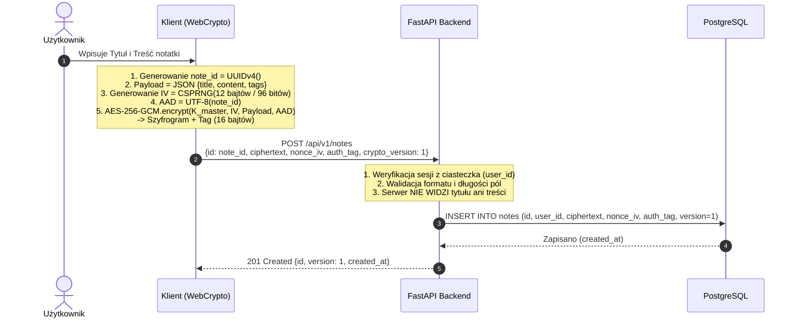
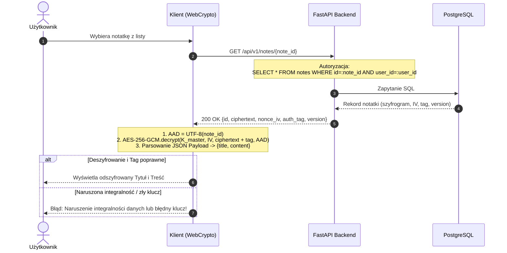

# Etap 1: Architektura, Model Zagrożeń i Projekt Systemu E2EE

> **Projekt**: Bezpieczna aplikacja notatek z szyfrowaniem End-to-End (E2EE)  
> **Przedmiot**: Zespołowy Projekt Inżynierski (ZPI / KCWD)  
> **Status**: Zaakceptowany projekt architektoniczny (Etap 1)  
> **Wersja**: 1.0.0  

---

## 1. Założenia i Wymagania

### 1.1. Podstawowy cel i zasada Zero-Knowledge
Głównym celem systemu jest zapewnienie użytkownikom możliwości bezpiecznego tworzenia, edytowania, odczytywania i usuwania prywatnych notatek w przeglądarce internetowej. System realizuje architekturę **Zero-Knowledge**:
* Treść notatki oraz jej tytuł podlegają szyfrowaniu wyłącznie po stronie klienta (w przeglądarce).
* Serwer aplikacyjny (FastAPI) oraz baza danych (PostgreSQL) operują **wyłącznie na szyfrogramach i metadanych**.
* Serwer nie posiada technicznej możliwości odszyfrowania danych użytkownika ani pozyskania jego kluczy prywatnych/symetrycznych.

### 1.2. Wymagania Funkcjonalne (FR)
1. **Rejestracja i Inicjalizacja Kryptograficzna**:
   - Użytkownik rejestruje się podając unikalny adres e-mail i silne hasło główne ($P$).
   - Klient generuje kryptograficznie bezpieczną sól użytkownika ($S_{user}$) o długości 128 bitów (16 bajtów).
   - Wyprowadzenie z hasła dwóch niezależnych kluczy: klucza uwierzytelniającego ($K_{auth}$) oraz klucza szyfrowania ($K_{master}$).
   - Wygenerowanie opcjonalnego klucza odzyskiwania konta (Recovery Key) w formacie mnemonika (np. BIP-39) lub 256-bitowego tokenu Base58.
2. **Uwierzytelnianie i Zarządzanie Sesją**:
   - Bezpieczne logowanie bez ujawniania hasła głównego $P$ ani klucza $K_{master}$.
   - Sesja zarządzana za pomocą bezpiecznych ciasteczek (`HttpOnly`, `Secure`, `SameSite=Lax/Strict`) przechowujących token sesyjny lub rotowany Refresh Token.
   - Możliwość wylogowania (unieważnienia bieżącej sesji lub wszystkich aktywnych sesji użytkownika).
3. **Zarządzanie Notatkami (CRUD)**:
   - **Tworzenie**: Klient generuje unikalny identyfikator UUIDv4 notatki, szyfruje tytuł i treść algorytmem AES-256-GCM z unikalnym 96-bitowym wektorem IV/nonce oraz wiąże szyfrogram z ID notatki za pomocą AAD (Additional Authenticated Data).
   - **Pobieranie listy**: Backend zwraca metadane i szyfrogramy; deszyfrowanie nagłówków następuje lokalnie w przeglądarce.
   - **Pobieranie pojedynczej notatki**: Zwrócenie pełnego rekordu z szyfrogramem i wektorem IV.
   - **Edycja**: Ponowne zaszyfrowanie zmodyfikowanej treści z nowym, losowym IV; wykrywanie konfliktów edycji przy użyciu optymistycznej blokady (nagłówek `If-Match` / numer wersji).
   - **Usuwanie**: Trwałe usunięcie (Hard Delete) rekordu z bazy danych wraz z szyfrogramem.

### 1.3. Wymagania Niefunkcjonalne (NFR)
1. **Poufność i Integralność (Security & Integrity)**:
   - Szyfrowanie symetryczne AEAD (Authenticated Encryption with Associated Data).
   - Odporność na manipulację szyfrogramem (Authentication Tag 128 bit).
   - Brak możliwości ataku typu replay/swap (wiązanie z kontekstem poprzez AAD).
2. **Wydajność (Performance)**:
   - Czas wyprowadzenia klucza KDF w przeglądarce (Argon2id) poniżej 500 ms na typowym urządzeniu klienckim przy zachowaniu wysokiego kosztu pamięciowego (np. $m=64\,\text{MB}, t=3, p=1$).
   - Czas odpowiedzi endpointów backendu poniżej 50 ms dla operacji CRUD (asynchroniczne zapytania w bazie danych z asyncpg).
3. **Izolacja Danych (Multi-Tenancy & Authorization)**:
   - Rygorystyczna separacja danych na poziomie zapytań SQL (`WHERE user_id = :current_user_id`).
   - Całkowite wyeliminowanie podatności BOLA/IDOR.

### 1.4. Ograniczenia i Widoczność Metadanych
System jawnie definiuje zakres informacji widocznych dla operatora serwera:
* **Widoczne dla serwera**:
  - Identyfikator użytkownika (`user_id` w formacie UUIDv4).
  - Adres e-mail użytkownika (lub pseudonimizowany skrót).
  - Hash klucza uwierzytelniającego (serwerowy hash z $K_{auth}$).
  - Sól KDF użytkownika ($S_{user}$) i parametry algorytmu Argon2id.
  - Identyfikator notatki (`note_id` - UUIDv4).
  - Rozmiar szyfrogramu (w bajtach).
  - Znaczniki czasu: `created_at`, `updated_at`.
  - Numer wersji formatu kryptograficznego (`crypto_version`) oraz wersja rekordu (`version` do optymistycznej blokady).
* **Niewidoczne dla serwera (Zaszyfrowane E2EE)**:
  - Tytuł notatki (jest zaszyfrowany w payloadzie).
  - Treść notatki.
  - Tagi, kategorie i załączniki (przechowywane w zaszyfrowanym obiekcie JSON payloadu).
* **Konsekwencje i Ograniczenia**:
  - Brak wyszukiwania pełnotekstowego (FTS) po stronie serwera. Wyszukiwanie odbywa się po stronie klienta w pamięci przeglądarki po pobraniu i odszyfrowaniu nagłówków/notatek.
  - Brak automatycznego resetu hasła z odzyskaniem notatek. Zresetowanie hasła konta bez klucza Recovery Key bezpowrotnie unieważnia dostęp do dotychczasowych zaszyfrowanych notatek.

---

## 2. Najważniejsze Decyzje Architektoniczne

| Obszar | Wybrana Technologia / Rozwiązanie | Alternatywy | Uzasadnienie |
| :--- | :--- | :--- | :--- |
| **Backend Framework** | **FastAPI (Python 3.12+)** | Django, Flask | Natywne wsparcie dla `asyncio`, automatyczna walidacja schematów Pydantic v2, generowanie specyfikacji OpenAPI, wysoka wydajność I/O. |
| **Baza danych i ORM** | **PostgreSQL + SQLAlchemy 2.0 (asyncpg)** | SQLite, MongoDB, Tortoise | Relacyjna spójność ACID, obsługa typów UUID i BYTEA, wysoka wydajność asynchronicznego sterownika `asyncpg`. |
| **Migracje bazy** | **Alembic** | yoyo-migrations | Standard branżowy dla SQLAlchemy, deterministyczna kontrola wersji schematu. |
| **Kryptografia klienta** | **Web Cryptography API (SubtleCrypto)** dla AES-256-GCM + **Argon2id (Wasm)** dla KDF | libsodium.js, CryptoJS, forge | `SubtleCrypto` działa w natywnym wątku C++ przeglądarki, chroni klucze przed bezpośrednim odczytem w pamięci JS, jest odporne na ataki czasowe (timing attacks). Brak podatności na podatne implementacje JS. |
| **Schemat wyprowadzania kluczy** | **Dual-Derivation Scheme (Argon2id + HKDF)** | Pojedynczy klucz do wszystkiego | Całkowita izolacja uwierzytelniania od szyfrowania. Backend weryfikuje $K_{auth}$, a $K_{master}$ nigdy nie opuszcza przeglądarki. |
| **Zarządzanie Sesją** | **HttpOnly, Secure, SameSite=Lax Cookies** (Session ID w bazie lub rotowany Refresh Token) | JWT w `localStorage` | Przechowywanie tokenów w `localStorage` naraża aplikację na natychmiastową kradzież sesji przy podatności XSS. Ciasteczka `HttpOnly` uniemożliwiają odczyt przez JavaScript. |
| **Architektura Kodu** | **Modularna architektura warstwowa** (Routers -> Services -> Repositories -> Models) | Clean/Hexagonal (przeinżynierowana), monolit w jednym pliku | Zapewnia czystą separację odpowiedzialności, ułatwia mockowanie i testowanie (Pytest), eliminuje powielanie zapytań SQL. |

---

## 3. Model Zagrożeń i Granice Zaufania (STRIDE)

### 3.1. Granice Zaufania (Trust Boundaries)
1. **TB-1: Środowisko Klienta (Przeglądarka Użytkownika)**:
   - Strefa zaufana dla użytkownika. Tutaj następuje wprowadzanie hasła, wyprowadzanie $K_{master}$ i operacje deszyfrowania.
   - Ryzyko: Złośliwe rozszerzenia przeglądarki, malware na hoście, podatności typu XSS.
2. **TB-2: Kanał Komunikacji (Sieć / TLS 1.3)**:
   - Strefa niezaufana chroniona kryptograficznie przez HTTPS (TLS).
   - Ryzyko: Podsłuch, ataki Man-in-the-Middle (mitigowane przez TLS i HSTS).
3. **TB-3: Serwer Aplikacyjny (FastAPI Backend)**:
   - Strefa pół-zaufana. Odpowiada za uwierzytelnianie, autoryzację i rate-limiting. **Nie ma dostępu do kluczy E2EE**.
   - Ryzyko: Błędy implementacji (BOLA), podatności bibliotek, kompromitacja uprawnień serwera.
4. **TB-4: Baza Danych (PostgreSQL)**:
   - Pół-zaufany magazyn danych.
   - Ryzyko: Wyciek backupu, zrzut bazy przez atak SQL Injection, nieautoryzowany dostęp administratora infrastruktury.



### 3.2. Szczegółowa Analiza Zagrożeń

| ID | Zagrożenie | Scenariusz Ataku | Wpływ | Zastosowane Zabezpieczenia | Ograniczenia i Ryzyko Resztkowe |
| :--- | :--- | :--- | :--- | :--- | :--- |
| **T-01** | **XSS (Cross-Site Scripting)** | Wstrzyknięcie złośliwego kodu JS do przeglądarki użytkownika. | **Krytyczny**: Możliwość odczytania klucza $K_{master}$ z pamięci RAM podczas aktywnej sesji i eksfiltracja notatek. | 1. Rygorystyczny Content Security Policy (CSP): `default-src 'self'; script-src 'self' 'wasm-unsafe-eval'`.<br>2. React domyślnie ucieka (escapuje) HTML.<br>3. Brak tokenów sesyjnych w `localStorage` (ciasteczka `HttpOnly`). | E2EE nie chroni przed XSS w trakcie aktywnej sesji (jeśli złośliwy kod przechwyci API WebCrypto w locie). Kluczowe jest całkowite zapobieganie XSS na poziomie CSP i higieny kodu. |
| **T-02** | **Przejęcie Bazy Danych (SQLi / Data Dump)** | Atakujący uzyskuje pełny zrzut bazy danych PostgreSQL. | **Niski dla treści notatek**, Średni dla metadanych. | 1. Wszystkie treści notatek są zaszyfrowane kluczem AES-256-GCM.<br>2. Hasła użytkowników to serwerowy hash z $K_{auth}$ (zabezpieczony podwójnie: Argon2id na kliencie + Argon2id na serwerze).<br>3. Parametryzowane zapytania SQLAlchemy 2.0 (ochrona przed SQLi). | Atakujący widzi relacje (kto jest właścicielem ilu notatek), czasy modyfikacji oraz rozmiary szyfrogramów. |
| **T-03** | **BOLA / IDOR (Insecure Direct Object Reference)** | Zalogowany użytkownik A próbuje odczytać lub zmodyfikować notatkę użytkownika B, podmieniając `note_id`. | **Wysoki**: Naruszenie prywatności innych użytkowników. | 1. Weryfikacja uprawnień w każdym zapytaniu SQL: `SELECT * FROM notes WHERE id = :note_id AND user_id = :current_user_id`.<br>2. Zwracanie błędu `404 Not Found` zamiast `403 Forbidden` (zapobiega enumeracji zasobów). | Wymaga rygorystycznego pokrycia testami integracyjnymi każdego endpointu. |
| **T-04** | **Brute-Force i Credential Stuffing** | Próby odgadnięcia hasła poprzez masowe wysyłanie żądań do `/api/v1/auth/login`. | **Średni**: Potencjalne przejęcie słabych kont. | 1. Rate limiting po IP i po koncie (FastAPI-Limiter / Slowapi).<br>2. Progresywne opóźnienia i blokada konta po $N$ nieudanych próbach.<br>3. Kosztowny KDF Argon2id po stronie klienta i serwera. | Atak rozproszony (botnet z wielu IP) może próbować pojedynczych haseł (password spraying). Wymagana polityka silnych haseł. |
| **T-05** | **CSRF (Cross-Site Request Forgery)** | Złośliwa strona nakłania przeglądarkę do wykonania akcji z ciasteczkiem sesyjnym. | **Wysoki**: Nieautoryzowane modyfikacje lub usunięcie notatek. | 1. Ciasteczka sesyjne z atrybutem `SameSite=Lax` lub `Strict`.<br>2. Wymóg niestandardowego nagłówka `X-Requested-With` lub dedykowany token CSRF dla operacji modyfikujących stan (POST, PUT, DELETE). | `SameSite=Lax` chroni przed większością ataków, ale dedykowana ochrona nagłówkiem eliminuje ryzyko w starych przeglądarkach. |
| **T-06** | **Ataki na Wektor IV / Nonce Reuse** | Użycie tego samego wektora IV dla tego samego klucza w algorytmie AES-GCM. | **Krytyczny**: Utrata poufności i możliwości fałszowania tagu uwierzytelniającego w GCM. | 1. Dla każdej operacji zapisu/aktualizacji generowany jest nowy, kryptograficznie losowy IV (96 bitów) z `crypto.getRandomValues()`.<br>2. Serwer odrzuca aktualizacje o identycznym IV. | Losowy 96-bitowy IV jest bezpieczny do $2^{32}$ szyfrowań per klucz. Po przekroczeniu zalecana rotacja klucza. |
| **T-07** | **Podmiana Szyfrogramów (Ciphertext Swapping)** | Atakujący z dostępem do bazy zamienia zaszyfrowaną treść notatki X z notatką Y tego samego użytkownika. | **Średni**: Użytkownik widzi treść innej notatki pod danym tytułem. | Zastosowanie **AAD (Additional Authenticated Data)**: do uwierzytelnienia AES-GCM dołączany jest identyfikator `note_id`. Przy próbie podstawienia szyfrogramu z innej notatki weryfikacja tagu zwróci błąd deszyfrowania. | Zabezpieczenie jest w pełni egzekwowane po stronie klienta. |
| **T-08** | **Kompromitacja Kodu JS (Supply Chain)** | Podmiana biblioteki npm w procesie budowania lub zainfekowanie serwera serwującego frontend. | **Krytyczny**: Zmodyfikowany kod może wysłać $K_{master}$ na zewnętrzny serwer. | 1. Blokowanie zewnętrznych domen w CSP (`connect-src 'self'`).<br>2. Używanie `package-lock.json` i audyty zależności (`npm audit` / Renovate).<br>3. Wersjonowanie i podpisywanie artefaktów. | E2EE opiera się na założeniu, że kod wykonywany w przeglądarce nie jest złośliwy w momencie uruchomienia. |

---

## 4. Diagramy Architektury i Przepływu Kryptograficznego

### 4.1. Przepływ Rejestracji i Derywacji Kluczy



### 4.2. Przepływ Uwierzytelniania (Logowanie)



### 4.3. Przepływ Tworzenia Notatki (Zapis Szyfrogramu)



### 4.4. Przepływ Odczytu i Odszyfrowania Notatki



---

## 5. Struktura Katalogów Projektu

Projekt podzielony jest na niezależne katalogi `backend` oraz `frontend` wewnątrz `faktyczna_Praca_final_final`.

```text
faktyczna_Praca_final_final/
├── docs/
│   ├── stage_1_architecture.md        # Niniejsza specyfikacja architektoniczna
│   └── threat_model.md                # Szczegółowa macierz ryzyk i wektorów ataku
├── docker-compose.yml                 # Definicja kontenerów: backend, db, frontend
├── docker-compose.override.yml        # Konfiguracja deweloperska (porty, wolumeny kodu)
├── .env.example                       # Wzorzec zmiennych środowiskowych (bez sekretów)
├── backend/
│   ├── Dockerfile                     # Produkcyjny i deweloperski obraz Pythona
│   ├── pyproject.toml                 # Zależności poetry/uv/pip, konfiguracja Ruff i Mypy
│   ├── alembic.ini                    # Konfiguracja migracji Alembic
│   ├── alembic/
│   │   ├── env.py                     # Asynchroniczne środowisko wykonawcze migracji
│   │   ├── script.py.mako             # Szablon skryptu migracji
│   │   └── versions/                  # Pliki migracji bazy danych
│   │       └── 001_initial_schema.py
│   ├── app/
│   │   ├── __init__.py
│   │   ├── main.py                    # Punkt startowy FastAPI, middleware (CORS, CSP, logery)
│   │   ├── core/                      # Konfiguracja bazowa i bezpieczeństwo serwera
│   │   │   ├── __init__.py
│   │   │   ├── config.py              # Pydantic Settings (odczyt zmiennych .env)
│   │   │   ├── security.py            # Serwerowe hashowanie (Argon2id), obsługa tokenów sesyjnych
│   │   │   ├── exceptions.py          # Ujednolicone wyjątki domenowe i obsługa błędów
│   │   │   └── rate_limiter.py        # Ograniczanie częstotliwości żądań
│   │   ├── db/                        # Warstwa bazy danych
│   │   │   ├── __init__.py
│   │   │   ├── session.py             # Asynchroniczny silnik SQLAlchemy (AsyncEngine, sessionmaker)
│   │   │   └── base.py                # Wspólna klasa bazowa Base (DeclarativeBase)
│   │   ├── models/                    # Modele bazodanowe SQLAlchemy 2.0
│   │   │   ├── __init__.py
│   │   │   ├── user.py                # Tabela users i user_sessions
│   │   │   └── note.py                # Tabela notes
│   │   ├── schemas/                   # Schematy walidacji Pydantic v2 (DTO)
│   │   │   ├── __init__.py
│   │   │   ├── auth.py                # Schematy rejestracji, logowania, soli
│   │   │   ├── note.py                # Schematy wejścia/wyjścia notatek (szyfrogramy)
│   │   │   └── common.py              # Schematy stronicowania, błędów
│   │   ├── repositories/              # Warstwa dostępu do danych (CRUD na bazie)
│   │   │   ├── __init__.py
│   │   │   ├── base.py
│   │   │   ├── user_repo.py
│   │   │   └── note_repo.py
│   │   ├── services/                  # Logika biznesowa (niezależna od frameworka)
│   │   │   ├── __init__.py
│   │   │   ├── auth_service.py        # Obsługa logowania, sesji, rate limitów
│   │   │   └── note_service.py        # Walidacja wersji, konflikty, autoryzacja
│   │   └── api/                       # Warstwa HTTP i endpointy
│   │       ├── __init__.py
│   │       ├── deps.py                # Wstrzykiwanie zależności (get_db, get_current_user)
│   │       └── v1/
│   │           ├── __init__.py
│   │           ├── router.py          # Rejestracja podrouterów v1
│   │           ├── endpoints/
│   │           │   ├── __init__.py
│   │           │   ├── auth.py        # /auth/register, /auth/login, /auth/logout
│   │           │   ├── users.py       # /users/me
│   │           │   └── notes.py       # /notes (CRUD)
│   └── tests/                         # Zestaw testów automatycznych
│       ├── __init__.py
│       ├── conftest.py                # Fixtury Pytest (testowa baza PostgreSQL/SQLite, klient HTTP)
│       ├── test_auth.py               # Testy rejestracji, logowania, sesji
│       ├── test_notes.py              # Testy CRUD notatek
│       ├── test_isolation.py          # Testy izolacji (próby IDOR użytkownik A vs B)
│       └── test_crypto_contracts.py   # Weryfikacja, że backend nie przyjmuje tekstu jawnego
└── frontend/
    ├── Dockerfile                     # Konteneryzacja frontendu (Vite dev lub Nginx prod)
    ├── package.json                   # React, Vite, TypeScript, Argon2 Wasm
    ├── tsconfig.json
    ├── vite.config.ts
    ├── index.html
    └── src/
        ├── main.tsx
        ├── App.tsx
        ├── api/                       # Komunikacja z API backendu (Axios / Fetch)
        │   └── client.ts
        ├── crypto/                    # Moduł kryptograficzny E2EE
        │   ├── kdf.ts                 # Argon2id + HKDF (wyprowadzanie K_auth i K_master)
        │   ├── cipher.ts              # AES-256-GCM (szyfrowanie, deszyfrowanie, AAD, IV)
        │   ├── keys.ts                # Bezpieczne zarządzanie materiałem klucza w pamięci
        │   └── serialization.ts       # Konwersje ArrayBuffer <-> Base64 / Hex
        ├── context/                   # Kontekst stanu autoryzacji i klucza szyfrowania
        │   └── AuthContext.tsx
        ├── components/                # Komponenty UI (formularze, lista, edytor)
        └── pages/                     # Widoki (Login, Register, Dashboard)
```

---

## 6. Projekt Bazy Danych PostgreSQL

### 6.1. Schemat Tabel Relacyjnych (DDL)

```sql
-- Włączenie rozszerzenia dla uniwersalnych identyfikatorów UUID
CREATE EXTENSION IF NOT EXISTS "uuid-ossp";

-- 1. Tabela Użytkowników
CREATE TABLE users (
    id UUID PRIMARY KEY DEFAULT uuid_generate_v4(),
    email VARCHAR(255) NOT NULL UNIQUE,
    password_hash VARCHAR(255) NOT NULL,       -- Serwerowy Argon2id hash obliczony z K_auth_client
    kdf_salt VARCHAR(64) NOT NULL,             -- Sól użytkownika w formacie Base64 (16 bajtów)
    kdf_params JSONB NOT NULL DEFAULT '{"algorithm": "argon2id", "m": 65536, "t": 3, "p": 1}',
    is_active BOOLEAN NOT NULL DEFAULT TRUE,
    created_at TIMESTAMP WITH TIME ZONE NOT NULL DEFAULT NOW(),
    updated_at TIMESTAMP WITH TIME ZONE NOT NULL DEFAULT NOW()
);

-- Indeks na email do szybkiego wyszukiwania przy logowaniu
CREATE INDEX idx_users_email ON users(email);

-- 2. Tabela Aktywnych Sesji Użytkowników (Zastępuje JWT w localStorage)
CREATE TABLE user_sessions (
    id UUID PRIMARY KEY DEFAULT uuid_generate_v4(),
    user_id UUID NOT NULL REFERENCES users(id) ON DELETE CASCADE,
    session_token_hash VARCHAR(64) NOT NULL UNIQUE, -- SHA-256 z wartości ciasteczka HttpOnly
    user_agent VARCHAR(512),
    ip_address VARCHAR(45),
    expires_at TIMESTAMP WITH TIME ZONE NOT NULL,
    created_at TIMESTAMP WITH TIME ZONE NOT NULL DEFAULT NOW(),
    last_seen_at TIMESTAMP WITH TIME ZONE NOT NULL DEFAULT NOW()
);

CREATE INDEX idx_sessions_token ON user_sessions(session_token_hash);
CREATE INDEX idx_sessions_user_id ON user_sessions(user_id);

-- 3. Tabela Zaszyfrowanych Notatek (Zero-Knowledge)
CREATE TABLE notes (
    id UUID PRIMARY KEY DEFAULT uuid_generate_v4(),
    user_id UUID NOT NULL REFERENCES users(id) ON DELETE CASCADE,
    
    -- Dane kryptograficzne (Zaszyfrowany JSON zawierający tytuł, treść, tagi)
    ciphertext TEXT NOT NULL,                  -- Zaszyfrowane dane (Base64)
    nonce_iv VARCHAR(32) NOT NULL,             -- 96-bitowy wektor IV (12 bajtów Base64)
    auth_tag VARCHAR(32) NOT NULL,             -- 128-bitowy tag integralności GCM (16 bajtów Base64)
    crypto_version INTEGER NOT NULL DEFAULT 1, -- Wersja schematu szyfrowania (1 = AES-256-GCM)
    
    -- Kontrola wersji i optymistyczna blokada
    version INTEGER NOT NULL DEFAULT 1,
    
    -- Metadane organizacyjne (jawne dla serwera, ale zminimalizowane)
    created_at TIMESTAMP WITH TIME ZONE NOT NULL DEFAULT NOW(),
    updated_at TIMESTAMP WITH TIME ZONE NOT NULL DEFAULT NOW(),
    
    -- Ochrona przed powtórzeniem IV dla tej samej notatki
    CONSTRAINT uq_note_nonce UNIQUE (id, nonce_iv)
);

-- Indeksy pod zapytania użytkownika (listowanie, sortowanie po dacie)
CREATE INDEX idx_notes_user_updated ON notes(user_id, updated_at DESC);
CREATE INDEX idx_notes_user_id_id ON notes(user_id, id);
```

### 6.2. Deklaratywne Modele SQLAlchemy 2.0 (Przykładowy Kod)

```python
# backend/app/models/note.py
import uuid
from datetime import datetime
from sqlalchemy import String, Integer, ForeignKey, DateTime, Text, UniqueConstraint
from sqlalchemy.dialects.postgresql import UUID
from sqlalchemy.orm import Mapped, mapped_column, relationship
from app.db.base import Base

class Note(Base):
    __tablename__ = "notes"
    __table_args__ = (
        UniqueConstraint("id", "nonce_iv", name="uq_note_nonce"),
    )

    id: Mapped[uuid.UUID] = mapped_column(
        UUID(as_uuid=True), primary_key=True, default=uuid.uuid4
    )
    user_id: Mapped[uuid.UUID] = mapped_column(
        UUID(as_uuid=True), ForeignKey("users.id", ondelete="CASCADE"), nullable=False, index=True
    )

    # Pola kryptograficzne - przechowują wyłącznie szyfrogram i parametry AEAD
    ciphertext: Mapped[str] = mapped_column(Text, nullable=False)
    nonce_iv: Mapped[str] = mapped_column(String(32), nullable=False)
    auth_tag: Mapped[str] = mapped_column(String(32), nullable=False)
    crypto_version: Mapped[int] = mapped_column(Integer, default=1, nullable=False)

    # Optymistyczna blokada współbieżności
    version: Mapped[int] = mapped_column(Integer, default=1, nullable=False)

    created_at: Mapped[datetime] = mapped_column(
        DateTime(timezone=True), default=datetime.utcnow, nullable=False
    )
    updated_at: Mapped[datetime] = mapped_column(
        DateTime(timezone=True), default=datetime.utcnow, onupdate=datetime.utcnow, nullable=False
    )

    # Relacja do użytkownika
    user: Mapped["User"] = relationship("User", back_populates="notes")
```

---

## 7. Specyfikacja REST API

Wszystkie endpointy biznesowe podlegają prefiksowi `/api/v1`.

### 7.1. Uwierzytelnianie i Zarządzanie Kontem (`/api/v1/auth`)

#### 1. `GET /api/v1/auth/kdf-params`
* **Opis**: Pobranie soli oraz parametrów KDF przypisanych do podanego adresu e-mail (krok wstępny przed wyliczeniem skrótów logowania).
* **Autoryzacja**: Publiczny (Rate Limited).
* **Parametry query**: `email: string` (wymagany).
* **Odpowiedź (200 OK)**:
  ```json
  {
    "kdf_salt": "q3v8J01l4M...==",
    "kdf_params": {
      "algorithm": "argon2id",
      "m": 65536,
      "t": 3,
      "p": 1
    }
  }
  ```
* **Kody błędów**:
  - `404 Not Found`: Dla uniknięcia enumeracji użytkowników serwer zwraca deterministycznie wygenerowaną fałszywą sól dla nieistniejącego e-maila (mitigacja account enumeration).

#### 2. `POST /api/v1/auth/register`
* **Opis**: Rejestracja nowego użytkownika.
* **Autoryzacja**: Publiczny (Strict Rate Limit: maks 5 prób/godzinę per IP).
* **Ciało żądania (Request Body)**:
  ```json
  {
    "email": "user@example.com",
    "auth_hash": "a8f5c3...64_hex_chars...",
    "kdf_salt": "q3v8J01l4M...==",
    "kdf_params": {
      "algorithm": "argon2id",
      "m": 65536,
      "t": 3,
      "p": 1
    }
  }
  ```
* **Odpowiedź (201 Created)**:
  ```json
  {
    "id": "c3b8b1a2-7212-4f32-8431-d25a6e297801",
    "email": "user@example.com",
    "created_at": "2026-10-27T10:00:00Z"
  }
  ```
* **Kody błędów**:
  - `400 Bad Request`: Błędny format danych / zbyt krótka sól.
  - `409 Conflict`: Użytkownik o podanym adresie e-mail już istnieje.
  - `429 Too Many Requests`: Przekroczono limit zapytań.

#### 3. `POST /api/v1/auth/login`
* **Opis**: Weryfikacja poświadczeń i utworzenie sesji (`Set-Cookie`).
* **Autoryzacja**: Publiczny (Rate Limit: 5 prób/minutę).
* **Ciało żądania**:
  ```json
  {
    "email": "user@example.com",
    "auth_hash": "a8f5c3...64_hex_chars..."
  }
  ```
* **Nagłówki odpowiedzi**:
  `Set-Cookie: session_id=s_9f82...; HttpOnly; Secure; SameSite=Lax; Path=/; Max-Age=604800`
* **Odpowiedź (200 OK)**:
  ```json
  {
    "user": {
      "id": "c3b8b1a2-7212-4f32-8431-d25a6e297801",
      "email": "user@example.com"
    },
    "message": "Authenticated successfully"
  }
  ```
* **Kody błędów**:
  - `401 Unauthorized`: Nieprawidłowy login lub hasło.
  - `429 Too Many Requests`: Konto czasowo zablokowane z powodu zbyt wielu błędnych prób.

#### 4. `POST /api/v1/auth/logout`
* **Opis**: Unieważnienie bieżącej sesji w bazie i wyczyszczenie ciasteczka.
* **Autoryzacja**: Uwierzytelniony.
* **Odpowiedź (200 OK)**: `{"message": "Logged out successfully"}`

#### 5. `GET /api/v1/auth/me`
* **Opis**: Informacja o aktualnie zalogowanym użytkowniku.
* **Autoryzacja**: Uwierzytelniony.
* **Odpowiedź (200 OK)**:
  ```json
  {
    "id": "c3b8b1a2-7212-4f32-8431-d25a6e297801",
    "email": "user@example.com",
    "created_at": "2026-10-27T10:00:00Z"
  }
  ```

---

### 7.2. Zarządzanie Notatkami (`/api/v1/notes`)

#### 1. `GET /api/v1/notes`
* **Opis**: Pobranie listy zaszyfrowanych notatek użytkownika (z paginacją).
* **Autoryzacja**: Uwierzytelniony.
* **Parametry query**:
  - `limit`: int (domyślnie 20, maks 100).
  - `offset`: int (domyślnie 0).
* **Odpowiedź (200 OK)**:
  ```json
  {
    "items": [
      {
        "id": "e4f5a6b7-8901-4bc3-a456-789012345678",
        "ciphertext": "k9L0xZ...==",
        "nonce_iv": "1a2b3c4d5e6f",
        "auth_tag": "9f8e7d6c5b4a3a2b1c0d",
        "crypto_version": 1,
        "version": 1,
        "created_at": "2026-10-27T10:15:00Z",
        "updated_at": "2026-10-27T10:15:00Z"
      }
    ],
    "total": 42,
    "limit": 20,
    "offset": 0
  }
  ```

#### 2. `POST /api/v1/notes`
* **Opis**: Utworzenie nowej zaszyfrowanej notatki.
* **Autoryzacja**: Uwierzytelniony.
* **Ciało żądania**:
  ```json
  {
    "id": "e4f5a6b7-8901-4bc3-a456-789012345678",
    "ciphertext": "k9L0xZ...==",
    "nonce_iv": "1a2b3c4d5e6f",
    "auth_tag": "9f8e7d6c5b4a3a2b1c0d",
    "crypto_version": 1
  }
  ```
* **Odpowiedź (201 Created)**:
  ```json
  {
    "id": "e4f5a6b7-8901-4bc3-a456-789012345678",
    "crypto_version": 1,
    "version": 1,
    "created_at": "2026-10-27T10:15:00Z",
    "updated_at": "2026-10-27T10:15:00Z"
  }
  ```
* **Kody błędów**:
  - `400 Bad Request`: Nieprawidłowy format Base64 lub niepoprawna długość IV/tagu.
  - `409 Conflict`: Notatka o podanym identyfikatorze UUID już istnieje.
  - `413 Payload Too Large`: Rozmiar szyfrogramu przekracza dopuszczalny limit (np. 10 MB).

#### 3. `GET /api/v1/notes/{note_id}`
* **Opis**: Pobranie szczegółów pojedynczej zaszyfrowanej notatki.
* **Autoryzacja**: Uwierzytelniony.
* **Odpowiedź (200 OK)**:
  ```json
  {
    "id": "e4f5a6b7-8901-4bc3-a456-789012345678",
    "ciphertext": "k9L0xZ...==",
    "nonce_iv": "1a2b3c4d5e6f",
    "auth_tag": "9f8e7d6c5b4a3a2b1c0d",
    "crypto_version": 1,
    "version": 3,
    "created_at": "2026-10-27T10:15:00Z",
    "updated_at": "2026-10-27T10:30:00Z"
  }
  ```
* **Kody błędów**:
  - `404 Not Found`: Notatka nie istnieje lub należy do innego użytkownika (mitigacja IDOR).

#### 4. `PUT /api/v1/notes/{note_id}`
* **Opis**: Aktualizacja zaszyfrowanej notatki z wykrywaniem konfliktów.
* **Autoryzacja**: Uwierzytelniony.
* **Ciało żądania**:
  ```json
  {
    "ciphertext": "nM39v...==",
    "nonce_iv": "9z8y7x6w5v4u",
    "auth_tag": "0a1b2c3d4e5f6a7b8c9d",
    "crypto_version": 1,
    "version": 3
  }
  ```
* **Odpowiedź (200 OK)**:
  ```json
  {
    "id": "e4f5a6b7-8901-4bc3-a456-789012345678",
    "version": 4,
    "updated_at": "2026-10-27T10:35:00Z"
  }
  ```
* **Kody błędów**:
  - `404 Not Found`: Brak notatki.
  - `409 Conflict`: Wersja w bazie jest wyższa niż przesłana w żądaniu (`version != db_version`), co oznacza, że notatka została zmodyfikowana na innym urządzeniu.

#### 5. `DELETE /api/v1/notes/{note_id}`
* **Opis**: Trwałe usunięcie notatki (Hard Delete).
* **Autoryzacja**: Uwierzytelniony.
* **Odpowiedź (204 No Content)**.

---

## 8. Strategia Uwierzytelniania i Zarządzania Kluczami

### 8.1. Wyprowadzanie Kluczy (Dual KDF Flow)
Aby bezwzględnie rozdzielić funkcję uwierzytelniania od dostępu do poufnych danych, zastosowano schemat dwustopniowy:

$$\text{Hasło } P \quad + \quad \text{Sól } S_{user} \xrightarrow{\text{Argon2id}} K_{derived} \;(256\text{ bit})$$

Z klucza $K_{derived}$ za pomocą standardu HKDF (RFC 5869) generowane są dwa kryptograficznie odseparowane klucze:
1. **Klucz Uwierzytelniający**:
   $$K_{auth} = \text{HKDF-Expand}(K_{derived}, \text{"zpi-notes-auth-v1"}, 32)$$
   Na kliencie obliczany jest skrót:
   $$\text{Hash}_{client} = \text{SHA-256}(K_{auth})$$
   Po przesłaniu do serwera, backend hashuje go ponownie:
   $$\text{Hash}_{server} = \text{Argon2id}(\text{Hash}_{client}, S_{server})$$
2. **Klucz Główny Szyfrowania (Master Encryption Key)**:
   $$K_{master} = \text{HKDF-Expand}(K_{derived}, \text{"zpi-notes-encryption-v1"}, 32)$$
   * $K_{master}$ jest importowany bezpośrednio do obiektu `CryptoKey` w przeglądarce (`extractable = false`).
   * **Nigdy** nie jest wysyłany do sieci, zapisywany w ciasteczkach ani utrwalany w `localStorage` / `sessionStorage`.

### 8.2. Cykl Życia Kluczy i Bezpieczeństwo Pamięci
* **Podczas sesji**: Klucz `CryptoKey` istnieje wyłącznie w pamięci operacyjnej JavaScript w module o zasięgu zamkniętym (closure).
* **Wylogowanie / Zamknięcie karty**: Następuje natychmiastowe usunięcie referencji do obiektu klucza, a serwer unieważnia sesję w bazie danych.
* **Reset Hasła i Odzyskiwanie Danych (Recovery Flow)**:
  - Zmiana hasła ze znajomością starego hasła: Klient odszyfrowuje dane kluczem $K_{master}^{old}$, wyprowadza nowy klucz $K_{master}^{new}$ z nowego hasła i przepakowuje szyfrogramy.
  - Utrata hasła: Standardowy reset hasła przez e-mail pozwala jedynie na zresetowanie dostępu do konta, ale **trwale uniemożliwia odczyt istniejących notatek**.
  - Opcjonalny klucz ratunkowy (Recovery Key): Przy rejestracji generowany jest 256-bitowy losowy klucz $K_{recovery}$ przedstawiany użytkownikowi w postaci mnemonika do wydruku offline. W bazie zapisywany jest $K_{master}$ zaszyfrowany kluczem $K_{recovery}$. Umożliwia to odzyskanie notatek bez hasła głównego.

---

## 9. Plan Zabezpieczeń i Konfiguracja Produkcyjna

### 9.1. Nagłówki Bezpieczeństwa HTTP
Aplikacja wymusza zestaw restrykcyjnych nagłówków w odpowiedziach Nginx i FastAPI:
* `Content-Security-Policy`:
  `default-src 'self'; script-src 'self' 'wasm-unsafe-eval'; style-src 'self' 'unsafe-inline'; img-src 'self' data:; connect-src 'self'; frame-ancestors 'none'; object-src 'none'; base-uri 'self';`
* `Strict-Transport-Security`: `max-age=63072000; includeSubDomains; preload`
* `X-Content-Type-Options`: `nosniff`
* `X-Frame-Options`: `DENY`
* `Referrer-Policy`: `strict-origin-when-cross-origin`
* `Permissions-Policy`: `camera=(), microphone=(), geolocation=()`

### 9.2. Rate Limiting i Ochrona Przed Atakami DoS
* `/api/v1/auth/login`: Maksymalnie 5 zapytań na minutę na pojedynczy adres IP.
* `/api/v1/auth/register`: Maksymalnie 3 rejestracje na godzinę z danego adresu IP.
* Globalne API: Maksymalnie 100 zapytań na minutę dla uwierzytelnionego użytkownika.

### 9.3. Bezpieczeństwo Logowania Zdarzeń (Logging Sanitization)
* Moduł logowania FastAPI filtruje nagłówki `Cookie`, `Authorization` oraz parametry żądań zawierające `auth_hash`, `ciphertext` lub `nonce_iv`.
* W logach serwerowych zapisywane są jedynie identyfikatory zdarzeń, kody statusu HTTP, czasy wykonania oraz zanonimizowane IP.

---

## Podsumowanie Etapu 1
Powyższy projekt w pełni realizuje wszystkie wymagania specyfikacji [AGENTS.md](../../AGENTS.md) dla **Etapu 1**. Stanowi on kompletną i jednoznaczną podstawę do wdrożenia szkieletu backendu, modeli bazodanowych, migracji oraz konfiguracji Docker Compose w **Etapie 2**.
