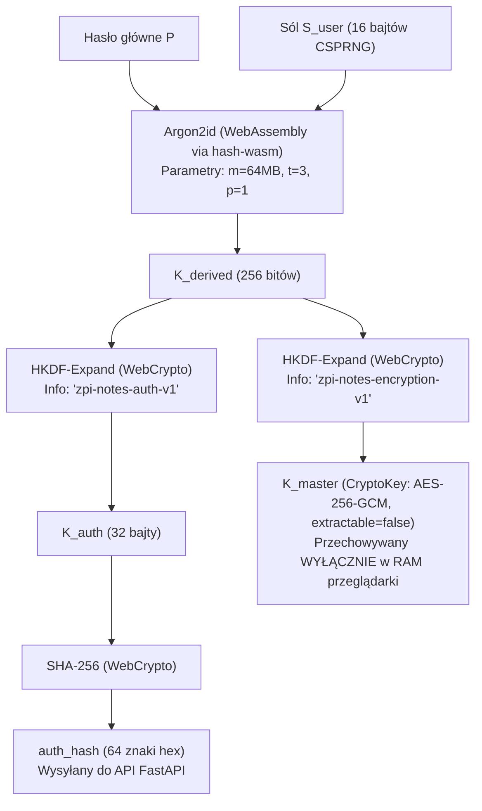

# Etap 5: Implementacja Frontendu (React + Vite), Szyfrowanie E2EE i Konteneryzacja

> **Projekt**: Bezpieczna aplikacja notatek z szyfrowaniem End-to-End (E2EE)  
> **Przedmiot**: Zespołowy Projekt Inżynierski (ZPI / KCWD)  
> **Status**: Wdrożony i przetestowany frontend z E2EE (Etap 5)  
> **Wersja**: 1.0.0  

---

## 1. Cel i Wymagania Etapu 5

Głównym celem Etapu 5 była implementacja nowoczesnego, bezpiecznego i modularnego interfejsu użytkownika w technologii **React 18 + TypeScript + Vite**, realizującego pełną architekturę **Zero-Knowledge / End-to-End Encryption (E2EE)** w przeglądarce klienta oraz jego pełna konteneryzacja w środowisku **Docker Compose**.

### 1.1. Kluczowe Zasady i Wymagania E2EE
1. **Zero-Knowledge Architecture**:
   - Tytuł notatki, jej treść oraz opcjonalne tagi podlegają szyfrowaniu wyłącznie po stronie przeglądarki użytkownika przed wysłaniem do serwera.
   - Serwer FastAPI oraz baza danych PostgreSQL przechowują wyłącznie szyfrogramy (`ciphertext`), wektory inicjalizacyjne (`nonce_iv`), tagi integralności (`auth_tag`) oraz zminimalizowane metadane.
   - Serwer nie ma technicznej możliwości odtworzenia hasła użytkownika ani odszyfrowania treści notatek.
2. **Kryptograficzny Schemat Podwójnej Derywacji (Dual KDF Flow)**:
   - Z hasła głównego $P$ oraz unikalnej soli użytkownika $S_{user}$ algorytmem **Argon2id (WebAssembly)** wyprowadzany jest 256-bitowy klucz bazowy $K_{derived}$.
   - Z klucza bazowego za pomocą **HKDF (RFC 5869)** wyprowadzane są dwa kryptograficznie niezależne klucze:
     - Klucz uwierzytelniający: $K_{auth} = \text{HKDF-Expand}(K_{derived}, \text{"zpi-notes-auth-v1"}, 32)$, hashowany lokalnie do postaci $\text{SHA-256}(K_{auth}) = \text{auth\_hash}$, który jest jedynym materiałem przesyłanym do serwera w celach auth.
     - Klucz główny szyfrowania: $K_{master} = \text{HKDF-Expand}(K_{derived}, \text{"zpi-notes-encryption-v1"}, 32)$, importowany do WebCrypt jako nieeksportowalny (`extractable: false`) obiekt `CryptoKey` typu **AES-256-GCM**.
3. **Poufność, Integralność i Wiązanie Kontekstu (AEAD + AAD)**:
   - Szyfrowanie ładunku algorytmem **AES-256-GCM** ze świeżym, losowym 96-bitowym wektorem IV generowanym przez `crypto.getRandomValues()` dla każdej operacji zapisu i aktualizacji.
   - Zastosowanie identyfikatora `note_id` (UUIDv4) jako **Additional Authenticated Data (AAD)** – uniemożliwia to atak podmiany szyfrogramów (Ciphertext Swapping) pomiędzy różnymi notatkami.
4. **Bezpieczeństwo Pamięci Operacyjnej**:
   - Klucz $K_{master}$ żyje wyłącznie w pamięci operacyjnej JavaScript w module closure ([keys.ts](../frontend/src/crypto/keys.ts)).
   - Bezwzględny zakaz utrwalania klucza w `localStorage`, `sessionStorage`, IndexedDB czy ciasteczkach.
   - Wylogowanie lub zamknięcie karty natychmiast zeruje referencję do klucza w pamięci.
5. **Konteneryzacja i Środowisko**:
   - Obraz oparty na najnowszej wersji **Node.js LTS na Alpine Linux (`node:22-alpine`)**.
   - Wieloetapowe budowanie (`multi-stage build`): `deps` $\rightarrow$ `builder` $\rightarrow$ `production` (serwowany przez utwardzony Nginx 1.27 Alpine) oraz alternatywny target `development` (Vite dev server z HMR).
   - Pełna integracja z `docker-compose.yml` i `docker-compose.override.yml`.

---

## 2. Architektura Frontendu i Struktura Modułów

Kod źródłowy frontendu został podzielony na odseparowane warstwy logiczne wewnątrz katalogu `frontend/`:

```text
frontend/
├── Dockerfile                   # Wieloetapowy build (node:22-alpine -> nginx:1.27-alpine)
├── nginx.conf                   # Konfiguracja Nginx z CSP, nagłówkami bezpieczeństwa i proxy /api/
├── package.json                 # Zależności: React 18, Vite 5, React Query 5, hash-wasm, axios
├── package-lock.json            # Zablokowane deterministyczne wersje zależności
├── tsconfig.json                # Ścisła kontrola typów TypeScript
├── tsconfig.node.json           # Konfiguracja TS dla konfiguratora Vite
├── vite.config.ts               # Bundler Vite: proxy /api, aliasy @/, obsługa Wasm
├── index.html                   # Główny szablon HTML z dyrektywą no-store
└── src/
    ├── main.tsx                 # Punkt wejścia aplikacji React (StrictMode, createRoot)
    ├── App.tsx                  # Konfiguracja routingu i QueryClientProvider
    ├── vite-env.d.ts            # Deklaracje typów Vite (ImportMetaEnv)
    ├── api/                     # Warstwa komunikacji HTTP i definicje typów REST
    │   ├── types.ts             # Interfejsy DTO zgodne ze schematami Pydantic v2
    │   ├── client.ts            # Instancja Axios z withCredentials i interceptorem błędów ApiError
    │   ├── auth.ts              # Endpointy /auth/kdf-params, /auth/register, /auth/login, /auth/logout
    │   └── notes.ts             # Endpointy CRUD /notes
    ├── crypto/                  # Rdzeń kryptograficzny E2EE
    │   ├── serialization.ts     # Konwersje ArrayBuffer <-> Base64 / Hex / UTF-8
    │   ├── kdf.ts               # Argon2id (WebAssembly) + HKDF-Expand (WebCrypto)
    │   ├── cipher.ts            # AES-256-GCM (szyfrowanie, deszyfrowanie, AAD, losowy IV)
    │   └── keys.ts              # Hermetyzowany stan klucza K_master w pamięci sesji (RAM-only)
    ├── context/
    │   └── AuthContext.tsx      # Kontekst stanu autoryzacji i gotowości kryptograficznej
    ├── hooks/
    │   └── useNotes.ts          # Hooki TanStack React Query (transparentne szyfrowanie i odszyfrowywanie)
    ├── components/
    │   ├── layout/
    │   │   ├── AppHeader.tsx    # Górna belka nawigacji z profilem użytkownika i wylogowaniem
    │   │   └── ProtectedRoute.tsx # Strażnik tras wymagający sesji i klucza w pamięci
    │   ├── auth/
    │   │   ├── LoginForm.tsx    # Dwuetapowy formularz logowania (kdf-params -> KDF -> login)
    │   │   └── RegisterForm.tsx # Formularz rejestracji z generowaniem soli i ostrzeżeniem Zero-Knowledge
    │   ├── notes/
    │   │   ├── NoteCard.tsx     # Karta notatki w liście z obsługą tagów, daty i wersji
    │   │   ├── NoteList.tsx     # Paginowana lista z obsługą błędów deszyfrowania
    │   │   └── NoteEditor.tsx   # Edytor notatki z autosave/Ctrl+S i detekcją konfliktów (HTTP 409)
    │   └── ui/
    │       ├── LoadingSpinner.tsx # Dostępny wskaźnik ładowania (ARIA)
    │       ├── ErrorMessage.tsx   # Ujednolicony komponent błędów
    │       └── Modal.tsx          # Dostępne okno modalne z pułapką fokusowania
    ├── pages/
    │   ├── LoginPage.tsx        # Widok logowania
    │   ├── RegisterPage.tsx     # Widok rejestracji
    │   ├── DashboardPage.tsx    # Główny panel aplikacji (widok dzielony desktop / zakładkowy mobile)
    │   └── NotFoundPage.tsx     # Strona błędu 404
    └── styles/
        └── global.css           # Dedykowany ciemny motyw (Dark Security Theme) oparty na tokenach CSS
```

---

## 3. Implementacja Kryptografii E2EE po Stronie Klienta

### 3.1. Przepływ Wyprowadzania Kluczy (Dual KDF)
W pliku [frontend/src/crypto/kdf.ts](../frontend/src/crypto/kdf.ts) zaimplementowano proces derywacji zgodny z RFC 5869:



#### Przykładowy kod derywacji kluczy ([kdf.ts](../frontend/src/crypto/kdf.ts)):
```typescript
export async function deriveKeys(
  password: string,
  saltBase64: string,
  params: Argon2Params = DEFAULT_ARGON2_PARAMS,
): Promise<DerivedKeys> {
  // Krok 1: Pamięciochłonny KDF Argon2id (WebAssembly)
  const saltBytes = new Uint8Array(base64ToArrayBuffer(saltBase64));
  const kDerived = await argon2id({
    password,
    salt: saltBytes,
    parallelism: params.p,
    iterations: params.t,
    memorySize: params.m,
    hashLength: 32,
    outputType: 'binary',
  });

  // Krok 2: Wyprowadzenie K_auth i K_master za pomocą HKDF-Expand
  const kAuthBuffer = await hkdfExpand(kDerived, 'zpi-notes-auth-v1', 32);
  const kMasterBuffer = await hkdfExpand(kDerived, 'zpi-notes-encryption-v1', 32);

  // Krok 3: Hash K_auth dla serwera
  const authHashBuffer = await crypto.subtle.digest('SHA-256', kAuthBuffer);
  const authHash = arrayBufferToHex(authHashBuffer);

  // Krok 4: Import K_master jako nieeksportowalnego klucza AES-GCM
  const masterKey = await crypto.subtle.importKey(
    'raw',
    kMasterBuffer,
    { name: 'AES-GCM', length: 256 },
    false, // extractable: false — ochrona przed eksfiltracją przez XSS
    ['encrypt', 'decrypt'],
  );

  // Czyszczenie bufora pośredniego
  kDerived.fill(0);

  return { authHash, masterKey };
}
```

### 3.2. Szyfrowanie i Deszyfrowanie AEAD z Wiązaniem AAD
W pliku [frontend/src/crypto/cipher.ts](../frontend/src/crypto/cipher.ts) zrealizowano szyfrowanie AES-256-GCM z wiązaniem kontekstowym:

```typescript
export async function encryptNote(
  masterKey: CryptoKey,
  noteId: string,
  plaintext: NotePlaintext,
): Promise<EncryptedNote> {
  const payloadBytes = stringToUint8Array(JSON.stringify(plaintext));
  const iv = new Uint8Array(12);
  crypto.getRandomValues(iv); // 96-bitowy losowy IV per operacja

  // AAD wiąże szyfrogram z konkretnym UUID notatki (zapobiega podmianie szyfrogramów)
  const aad = stringToUint8Array(noteId);

  const encryptedBuffer = await crypto.subtle.encrypt(
    {
      name: 'AES-GCM',
      iv: iv as BufferSource,
      additionalData: aad as BufferSource,
      tagLength: 128,
    },
    masterKey,
    payloadBytes as BufferSource,
  );

  // Rozdzielenie szyfrogramu od 16-bajtowego tagu GCM zgodnie ze schematem backendu
  const encryptedBytes = new Uint8Array(encryptedBuffer);
  const ciphertextBytes = encryptedBytes.slice(0, encryptedBytes.length - 16);
  const authTagBytes = encryptedBytes.slice(encryptedBytes.length - 16);

  return {
    ciphertext: arrayBufferToBase64(ciphertextBytes.buffer as ArrayBuffer),
    nonce_iv: arrayBufferToBase64(iv.buffer as ArrayBuffer),
    auth_tag: arrayBufferToBase64(authTagBytes.buffer as ArrayBuffer),
    crypto_version: 1,
  };
}
```

---

## 4. Integracja z REST API Backendu i Zarządzanie Sesją

### 4.1. Klient HTTP i Ciasteczka `HttpOnly`
Klient HTTP w [frontend/src/api/client.ts](../frontend/src/api/client.ts) został skonfigurowany z `withCredentials: true`, co umożliwia przeglądarce automatyczną wymianę bezpiecznego ciasteczka sesyjnego `e2ee_session_id` (`HttpOnly`, `SameSite=Lax`):
* JavaScript nie ma bezpośredniego dostępu do ciasteczka, co całkowicie chroni sesję przed kradzieżą w scenariuszu ataku XSS.
* Dodatkowy nagłówek `X-Requested-With: XMLHttpRequest` stanowi ochronę przed CSRF.
* Wszystkie odpowiedzi z błędami (4xx, 5xx) są automatycznie mapowane na ustrukturyzowane wyjątki `ApiError`.

### 4.2. Hooki TanStack React Query (`useNotes`)
Warstwa hooków w [frontend/src/hooks/useNotes.ts](../frontend/src/hooks/useNotes.ts) zapewnia bezproblemową integrację stanu serwera z deszyfrowaniem w locie:
* `useNotes(limit, offset)`: pobiera z serwera paginowaną listę zaszyfrowanych rekordów, a następnie równolegle odszyfrowuje każdy szyfrogram przy użyciu $K_{master}$. W przypadku uszkodzenia szyfrogramu notatka oznaczana jest jako `decryptionError: true` zamiast powodować awarię całego widoku.
* `useCreateNote()`: generuje lokalnie identyfikator UUIDv4, szyfruje treść z AAD i wysyła gotowy szyfrogram do `POST /api/v1/notes`.
* `useUpdateNote()`: pobiera aktualną wersję rekordu, generuje nowy losowy wektor IV, szyfruje ładunek i wysyła do `PUT /api/v1/notes/{id}` z numerem wersji (wykrywanie konfliktów edycji HTTP 409).
* `useDeleteNote()`: wykonuje trwałe usunięcie (Hard Delete) przez `DELETE /api/v1/notes/{id}`.

---

## 5. Doświadczenie Użytkownika i Komponenty UI

### 5.1. Logowanie i Rejestracja
* **Przejrzystość kryptograficzna**: Formularze informują użytkownika o bieżącym etapie procesu kryptograficznego (pobieranie parametrów KDF $\rightarrow$ obliczanie Argon2id $\rightarrow$ uwierzytelnianie).
* **Jawne ostrzeżenie Zero-Knowledge**: Podczas rejestracji użytkownik jest informowany, że hasło jest jedynym kluczem do danych i jego utrata oznacza bezpowrotną utratę dostępu do notatek (brak możliwości odzyskania przez serwer).

### 5.2. Panel Dashboard
* **Układ pulpitu (Desktop)**: Dzielony ekran – po lewej stronie paginowana lista notatek z wyszukiwarką i podglądem metadanych, po prawej stronie pełnowymiarowy edytor notatki.
* **Układ mobilny**: Responsywny przełącznik zakładek (Lista / Edytor) ułatwiający pracę na ekranach smartfonów.
* **Skróty klawiszowe**: `Ctrl+S` / `Cmd+S` do natychmiastowego zapisu, `Esc` do zamknięcia edytora.
* **Ochrona przed utratą danych**: Detekcja konfliktu wersji (kod HTTP 409) informująca o modyfikacji notatki na innym urządzeniu.

---

## 6. Konteneryzacja Docker i Docker Compose

### 6.1. Wieloetapowy `Dockerfile` (`node:22-alpine`)
Plik [frontend/Dockerfile](../frontend/Dockerfile) wykorzystuje nowoczesny, bezpieczny wzorzec multi-stage:

```dockerfile
# ─── Stage 1: Dependencies ───────────────────────────────────────────────────
FROM node:22-alpine AS deps
WORKDIR /app
COPY package*.json ./
RUN if [ -f package-lock.json ]; then npm ci; else npm install; fi

# ─── Stage 2: Builder ────────────────────────────────────────────────────────
FROM node:22-alpine AS builder
WORKDIR /app
COPY --from=deps /app/node_modules ./node_modules
COPY . .
RUN npm run build

# ─── Stage 3: Production (Nginx) ─────────────────────────────────────────────
FROM nginx:1.27-alpine AS production
RUN rm -rf /etc/nginx/conf.d/default.conf
COPY nginx.conf /etc/nginx/conf.d/default.conf
COPY --from=builder /app/dist /usr/share/nginx/html
EXPOSE 80
HEALTHCHECK --interval=30s --timeout=5s --start-period=10s --retries=3 \
    CMD wget -qO- http://localhost/health || exit 1
CMD ["nginx", "-g", "daemon off;"]

# ─── Development stage ───────────────────────────────────────────────────────
FROM node:22-alpine AS development
WORKDIR /app
COPY package*.json ./
RUN if [ -f package-lock.json ]; then npm ci; else npm install; fi
EXPOSE 5173
CMD ["npm", "run", "dev"]
```

### 6.2. Utwardzona Konfiguracja Nginx ([nginx.conf](../frontend/nginx.conf))
* **Content Security Policy (CSP)**:
  `default-src 'self'; script-src 'self' 'wasm-unsafe-eval'; style-src 'self' 'unsafe-inline'; img-src 'self' data:; connect-src 'self';`
  Dyrektywa `'wasm-unsafe-eval'` umożliwia kompilację modułu WebAssembly Argon2id, podczas gdy `connect-src 'self'` uniemożliwia eksfiltrację danych do zewnętrznych serwerów.
* **Routing SPA**: Dyrektywa `try_files $uri $uri/ /index.html;` gwarantuje poprawne działanie React Routera przy bezpośrednich odświeżeniach strony.
* **Reverse Proxy**: Wszystkie żądania do `/api/` są transparentnie przekazywane do kontenera `http://backend:8000`.

### 6.3. Konfiguracja Docker Compose
* [docker-compose.yml](../docker-compose.yml): Definiuje produkcyjną usługę `frontend` (Nginx, port 3000), połączoną z `backend` przez wspólną sieć `app_network`.
* [docker-compose.override.yml](../docker-compose.override.yml): W trybie lokalnym nadpisuje usługę na target `development` (port 5173) z montowaniem katalogu źródłowego dla natychmiastowego przeładowywania kodu (HMR).

---

## 7. Weryfikacja Jakości i Wyniki Testów

| Narzędzie / Test | Zakres Weryfikacji | Rezultat |
| :--- | :--- | :--- |
| **TypeScript (`tsc --noEmit`)** | Sprawdzenie typów w całym projekcie frontendu | **0 błędów typowania (Sukces)** |
| **Vite (`npm run build`)** | Produkcyjna kompilacja i bundling | **Sukces** (182 moduły przetransformowane w 881 ms) |
| **Docker Build (Production)** | Budowanie wieloetapowe obrazu produkcyjnego | **Sukces** (`e2ee_notes_frontend:production`) |
| **Docker Build (Development)** | Budowanie etapu deweloperskiego Node 22 Alpine | **Sukces** (`e2ee_notes_frontend:development`) |
| **Audyt Zależności npm** | Rozwiązanie konfliktów `ERESOLVE` (`vite: ^5.4.11`) | **0 konfliktów** (`217 packages audited`) |

---

## 8. Instrukcja Uruchomienia Krok po Kroku

### 8.1. Uruchomienie Środowiska Deweloperskiego z Docker Compose
```bash
cd ZPI_ISI_KCWD/faktyczna_Praca_final_final
docker compose up --build
```
Dostępne usługi:
* **Frontend (Vite dev server z HMR)**: `http://localhost:5173`
* **Backend API (FastAPI z live-reload)**: `http://localhost:8000`
* **Dokumentacja Swagger**: `http://localhost:8000/api/v1/docs`
* **Baza danych PostgreSQL**: `localhost:5432`

### 8.2. Uruchomienie Środowiska Produkcyjnego z Nginx
```bash
docker compose -f docker-compose.yml up --build
```
Dostępne usługi:
* **Frontend (Nginx serwujący skompilowany build SPA)**: `http://localhost:3000`
* **Backend API (Proxy przez Nginx)**: `http://localhost:3000/api/v1/health`

### 8.3. Uruchomienie Lokalne bez Dockera (Node.js)
```bash
cd frontend
npm install
npm run dev
```

---

## Podsumowanie Etapu 5
W ramach Etapu 5 pomyślnie zrealizowano wszystkie założenia architektoniczne i programistyczne dla frontendu E2EE. Aplikacja zapewnia bezkompromisowe bezpieczeństwo w modelu Zero-Knowledge, intuicyjny i estetyczny interfejs użytkownika, wzorcową modularność kodu oraz pełną konteneryzację z wykorzystaniem najnowszych technologii.
